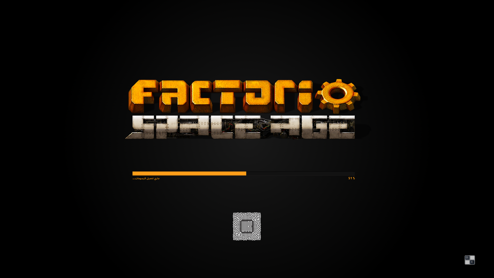

# Factorio 2.1.24 Arabic Translation | تعريب Factorio

> **ابنِ مصنعك… وخلي كل تفاصيل Factorio بالعربي.**
>
> Play Factorio 2.1.24 in connected Arabic. This community translation patch includes **8,291 strings**, right-to-left reading order, and the Space Age content.

[⬇ Download the latest release](https://github.com/mosa8899/Factorio_2.1.24_Arabic_Locale/releases/latest) · [Report a translation issue](https://github.com/mosa8899/Factorio_2.1.24_Arabic_Locale/issues/new)

**Supported game build:** Factorio 2.1.24 (build 87808) · **Install type:** manual locale patch · **Tested on:** Linux Mint 22.3

> This is a manual locale patch, not a Mod Portal mod. It installs Arabic locale files into the Factorio game folder and sets the game locale to `ar`.

## What’s included

| Item | Details |
|---|---|
| Game version | Factorio 2.1.24 — build 87808 |
| Translation | 8,291 translatable strings across 29 CFG files |
| Content | Base game, Space Age, Quality, Elevated Rails, Recycler, campaigns, scenarios, and tutorials |
| Arabic display | Connected letter shapes and right-to-left reading order, prepared for Factorio’s text renderer |
| Tested | Linux Mint 22.3 / Cinnamon / X11; other platforms have not been tested by this project |

## Preview



## Quick installation

1. Download `Factorio_2.1.24_Arabic_Locale.zip` from the [latest release](https://github.com/mosa8899/Factorio_2.1.24_Arabic_Locale/releases/latest).
2. Close Factorio completely.
3. Extract the archive into the Factorio installation folder that contains both `data` and `bin`. Keep the archive’s folder structure.
4. In `config/config.ini`, set the value under `[general]` to:

   ```ini
   locale=ar
   ```

5. Start Factorio. If needed, choose **Settings → Interface → Language → العربية**.

Use this patch only with **Factorio 2.1.24 build 87808**. A game update or Steam file verification can restore the original files; reinstall the matching release afterward. See the detailed Arabic instructions below.

---

## التفاصيل بالعربي

تعريب مجتمعي كامل مبني على ملفات اللغة الإنجليزية للعبة **Factorio 2.1.24 (build 87808)**. يشمل اللعبة الأساسية وتوسعة **Space Age** ومحتوى **Quality** و**Elevated Rails** و**Recycler**، إضافةً إلى الحملات والسيناريوهات والدروس التعليمية.

| التفصيل | القيمة |
|---|---|
| إصدار اللعبة المدعوم | 2.1.24 — build 87808 |
| عدد الملفات | 29 ملف CFG + ملف info.json |
| عدد النصوص | 8,291 نصًا، مطابقة لمفاتيح ملفات `en` |
| عرض العربية | حروف متصلة واتجاه قراءة من اليمين إلى اليسار، مجهّز لمحرك عرض اللعبة |
| الاختبار | Linux Mint 22.3 / Cinnamon / X11؛ الأنظمة الأخرى لم تُختبر في هذا المشروع |

### هل اللعبة 100% عربية؟

كل النصوص القابلة للترجمة في الحزمة عربية: **8,291 من 8,291**. تبقى بعض الرموز التقنية وأسماء المنتجات والوحدات كما هي حتى لا يتغير معناها أو تتعطل وسوم اللعبة. أمثلة: `Factorio`، `Steam`، `Alt`، `°C`، `__1__`، ووسوم مثل `[entity=...]`.

### طريقة التركيب

1. أغلق اللعبة تمامًا قبل التركيب.
2. افتح مجلد Factorio الذي يحتوي على المجلدين `data` و`bin`.
3. فك ضغط الحزمة داخل هذا المجلد مباشرةً، مع الحفاظ على المجلدات الموجودة داخل الأرشيف. لا تفكها داخل `data` أو `locale`.
4. افتح `config/config.ini`، وتحت القسم `[general]` غيّر قيمة `locale` إلى:

   ```ini
   locale=ar
   ```

5. شغّل اللعبة، واختر **الإعدادات ← الواجهة ← اللغة ← العربية (ar)** إذا لم تكن مختارة.

لا تحذف مجلدات `en`؛ اللعبة تستخدمها كمرجع. إذا أنشأ برنامج فك الضغط مجلدًا باسم الأرشيف، انسخ محتوى مجلد `data` إلى مجلد اللعبة الذي يحتوي على مجلد `data` الأصلي.

### الإبلاغ عن خطأ أو المساعدة في تحسين التعريب

افتح [بلاغًا جديدًا](https://github.com/mosa8899/Factorio_2.1.24_Arabic_Locale/issues/new)، وأرفق إصدار اللعبة، والنص الإنجليزي، والترجمة الحالية، واقتراحك العربي. هذا يساعد على مراجعة المصطلحات وإصلاح الأخطاء.

### استعادة الإنجليزية

غيّر `locale=ar` إلى `locale=en` في `config/config.ini`. لاستعادة ملفات اللعبة الأصلية، استخدم ميزة التحقق من الملفات في Steam أو أعد الملفات الأصلية من نسخة احتياطية. بعد تحديث اللعبة، استخدم حزمة مطابقة للإصدار الجديد.

### الإسناد

هذا التعريب غير رسمي، ويستخدم ملفات `en` من Factorio 2.1.24 مرجعًا بنيويًا. بدأت المراجعة من مسودة مجتمعية من مشروع [F2lcon01/factorio01](https://github.com/F2lcon01/factorio01)، ثم روجعت النصوص مقابل الملفات الإنجليزية وأعيدت صياغة المصطلحات والجمع والأسلوب.

Factorio وSpace Age علامتان تجاريتان لشركة Wube Software. راجع رخصة المصدر قبل إعادة نشر الحزمة أو تضمينها في مشروع آخر.
